# Kori

Kori is an offline-first safari and wildlife app for Botswana, named after the
kori bustard (kgori in Setswana), the national bird.

You log a sighting with no signal (species, time, photos, a coarse location),
and it waits on your phone until a connection returns. Reviewers approve
sightings before anyone else sees them. Park maps are downloaded before the
trip, so the map and your GPS position work with no mobile signal. Guidance to
a sighting follows known roads and tracks only, and a sighting can be shared
phone to phone with a QR code.

## What it looks like

Screenshots of the running prototype in Day colours (Night is the same layout in deep
blue-green, and one button switches between them). Everything on screen is **sample
data**: the reserve, the sightings, the observers and the reviews are invented, and the
reserve is fictional, so it must not be used to navigate. The apps' "Demo data" chips link
to a plain statement of this. The map screens show that fictional reserve and will be
re-taken when the real map (work order KO-25) replaces it.

<table>
  <tr>
    <td width="50%" valign="top" align="center">
      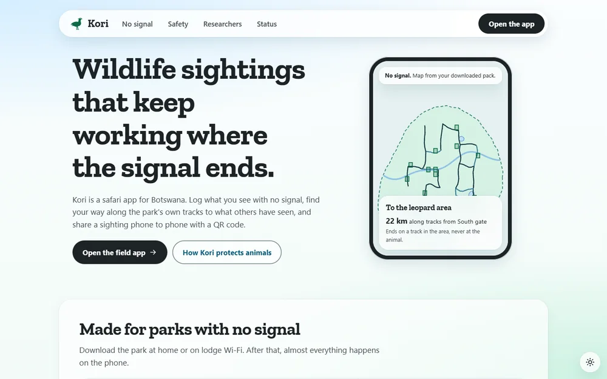<br>
      <sub><b>Landing site.</b> What Kori is, and what works with no signal.</sub>
    </td>
    <td width="50%" valign="top" align="center">
      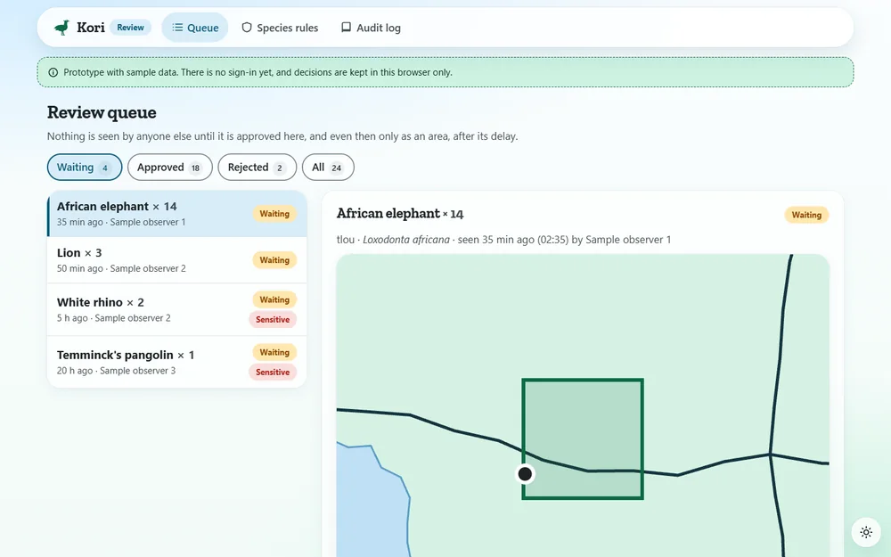<br>
      <sub><b>Review console.</b> Reviewers approve or reject sightings before anyone else sees them.</sub>
    </td>
  </tr>
  <tr>
    <td width="50%" valign="top" align="center">
      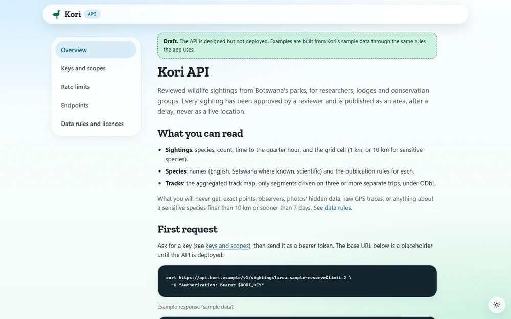<br>
      <sub><b>API docs</b> (draft). Keys, limits and endpoints for researchers and lodges.</sub>
    </td>
    <td width="50%" valign="top" align="center">
      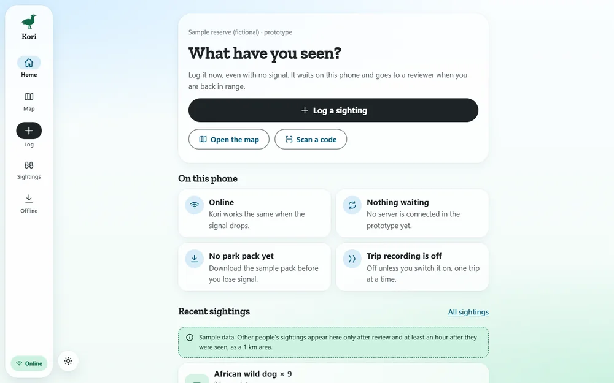<br>
      <sub><b>Field app on a wide screen.</b> The same app, with a rail instead of the bottom dock.</sub>
    </td>
  </tr>
</table>

On a phone:

<table>
  <tr>
    <td width="50%" valign="top" align="center">
      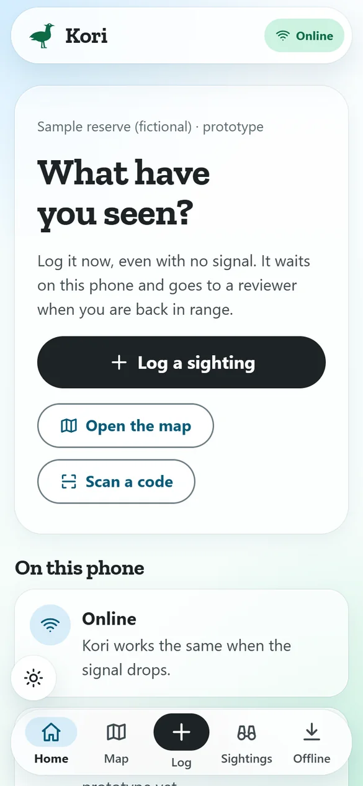<br>
      <sub><b>Home.</b> Log a sighting, even with no signal.</sub>
    </td>
    <td width="50%" valign="top" align="center">
      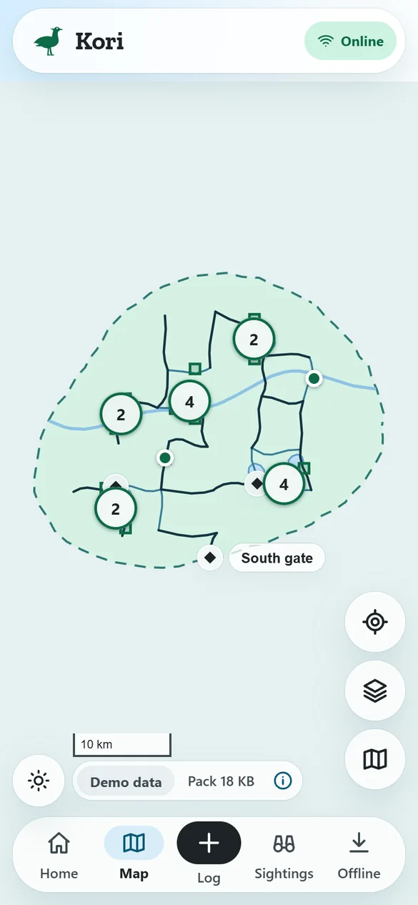<br>
      <sub><b>Map</b>, drawn from the downloaded pack. The reserve is fictional.</sub>
    </td>
  </tr>
  <tr>
    <td width="50%" valign="top" align="center">
      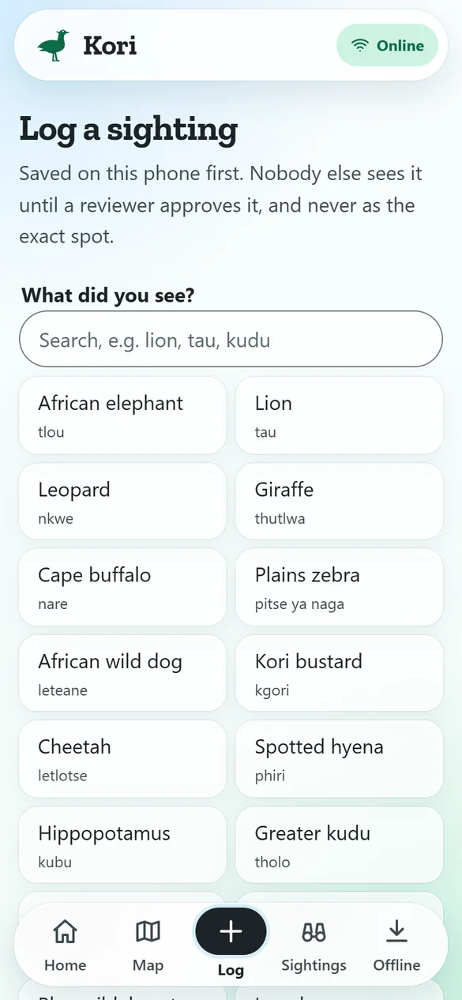<br>
      <sub><b>Log a sighting.</b> Saved on the phone first.</sub>
    </td>
    <td width="50%" valign="top" align="center">
      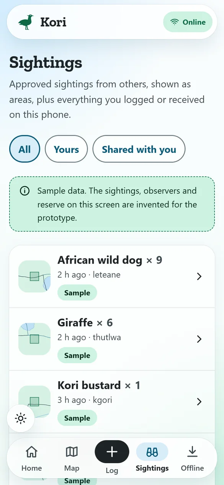<br>
      <sub><b>Sightings.</b> Each is shown as a 1 km area, never a point.</sub>
    </td>
  </tr>
  <tr>
    <td width="50%" valign="top" align="center">
      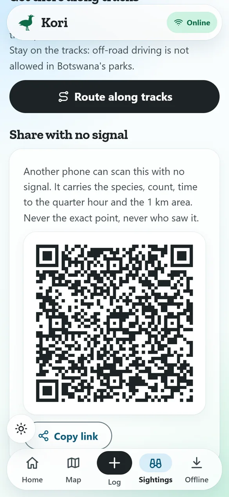<br>
      <sub><b>A sighting with its QR share.</b> Another phone scans it with no signal.</sub>
    </td>
    <td width="50%" valign="top" align="center">
      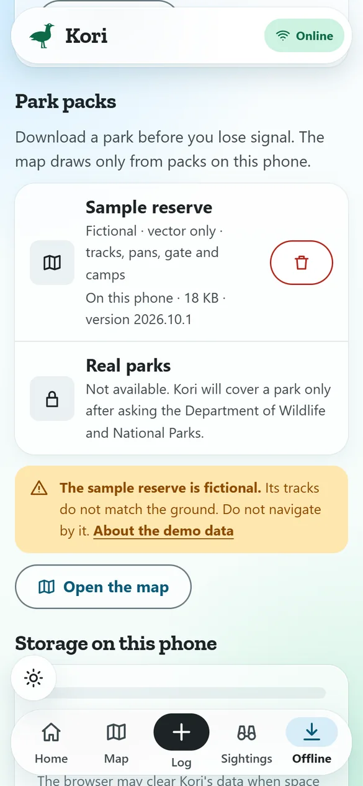<br>
      <sub><b>Offline and packs.</b> What is stored on the phone.</sub>
    </td>
  </tr>
  <tr>
    <td width="50%" valign="top" align="center">
      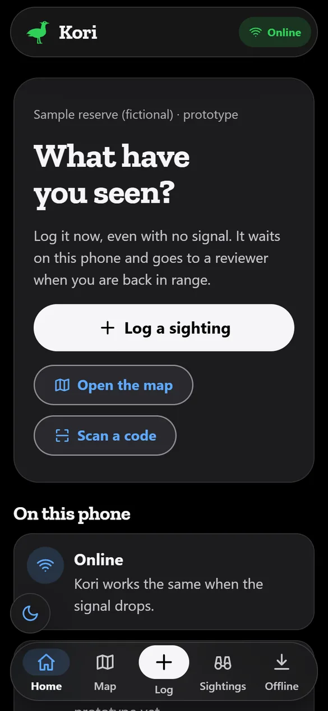<br>
      <sub><b>Night colours</b>, home.</sub>
    </td>
    <td width="50%" valign="top" align="center">
      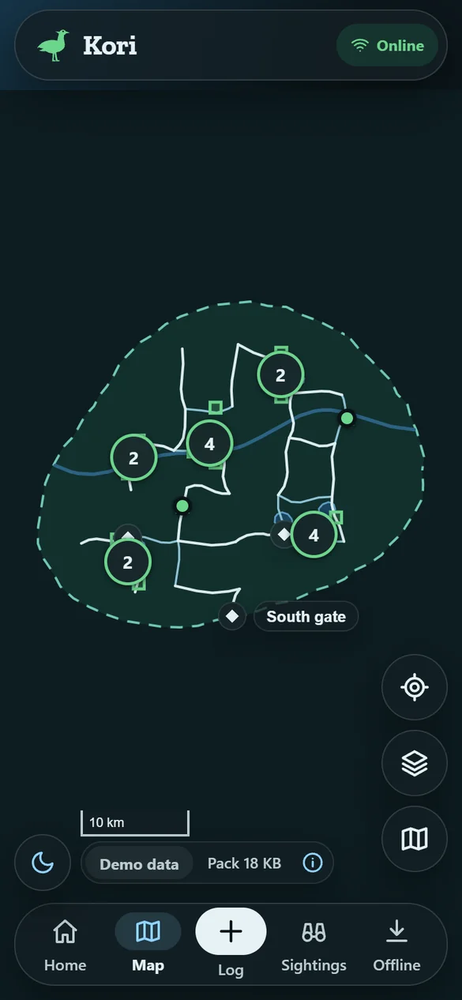<br>
      <sub><b>Night colours</b>, map.</sub>
    </td>
  </tr>
</table>

## State of the work

An early prototype. The web apps run in the browser with **sample data**; the
backend is a **scaffold** that passes its tests and starts in CI but is not
deployed or connected to the apps yet. The register of work, with honest states
and evidence, is [`docs/WORK_ORDERS.md`](docs/WORK_ORDERS.md).

### Real, scaffold, sample, not built

| | What | How it was checked |
| --- | --- | --- |
| **Real, runs in the browser** | Logging a sighting into the phone's storage (IndexedDB), with photos redrawn on the phone to strip hidden location data; the offline outbox; downloading the sample park pack and drawing it with MapLibre without tiles; your GPS position on the map; routing along tracks on the phone; QR codes and the scanner; opt-in trip recording on the phone; the review console's queue and audit log (decisions kept in the browser); Day and Night colours. | Lint, typecheck and build pass for all four apps in CI. Clicked through in a browser: pack download, map, logging, the delay rule, QR display, routing. Not tried on a real phone: the service worker, live GPS, camera scanning, photo re-encoding, trip recording. |
| **Scaffold: code that runs, not yet in use** | The API (accounts, scoped keys, quotas, throttling, audit log, uploads, privacy export and deletion, sighting submission, review, trips, track map, packs, the keyed `/v1` API); migrations to PostGIS; the compose stack; observability (Prometheus, Grafana, Tempo); backup and recovery scripts; release and Kubernetes files; the field app's `HttpStore`. | `pytest`: 93 passed. CI migrates an empty PostGIS 16 database to head and back. CI builds and starts the database and API with compose; `/api/health` reports `healthy`. Monitoring, backups, drills and the rest of the stack have **not** been started. |
| **Sample data** | Every sighting not logged by you, every observer ("Sample observer 1" and so on), every review, the invented API keys in the docs, and the reserve itself, which is **fictional**: its tracks are generated and do not match the ground at its coordinates. | Labelled where it appears: a small "Demo data" chip (landing footer, the map, sighting pages) links to a plain statement of what is invented; lists of sightings carry a note; the map's (i) panel and the Offline and packs page warn that the reserve must not be navigated by. |
| **Not built yet** | Sign-in in the apps and the apps calling the API; real park packs; sharing trips and the track map built from many trips; Kori-specific metrics; deployment; human-wildlife conflict reports and camera-trap uploads (proposed); predicted tracks from satellite imagery, which wait on a separate feasibility check. | See the register. |

## Safety and privacy

Kori never shows a live animal location: others see a sighting only after
review, at least an hour later, and only as a 1 km area. Sensitive species
(rhino and pangolin in the prototype), dens and nests are a 10 km area after
7 days, and are never guided to or shared. Guidance stays on existing tracks.
Predicted tracks are labelled with their confidence and are off by default.
Trip recording is opt-in per trip, and shared trips are trimmed and deleted on
expiry. The rules run in both the browser and the API, and tests keep the two
identical. Full rules: [`docs/SAFETY_AND_PRIVACY.md`](docs/SAFETY_AND_PRIVACY.md).

## Repository layout

| Path | What it is |
| --- | --- |
| `apps/field/` | The field app (Next.js 16): home, log, map, sightings, sighting with QR share, scan, offline and packs, trips |
| `apps/landing/` | The landing site |
| `apps/review/` | The review console: queue with checks, approve or reject, species rules, audit log |
| `apps/api-docs/` | The API docs (draft); the endpoint table comes from the API's OpenAPI document |
| `shared/` | Tokens, mark and icons, species, publication rules, the sample reserve, routing, share codes; copied into each app by `node scripts/sync-shared.mjs` |
| `api/` | The FastAPI service, Alembic migrations and tests ([`api/README.md`](api/README.md)) |
| `database/`, `compose.yaml` | The PostGIS image and the local stack |
| `observability/`, `ops/`, `deploy/` | Monitoring, backup and recovery, release and Kubernetes scaffolds |
| `docs/` | Safety and privacy rules, design principles, ADRs, deploy, observability and operations guides, the work-order register |
| `tests/`, `scripts/` | Tests for the shared code; sync, name gate, reuse measurement |

How the parts fit: [`ARCHITECTURE.md`](ARCHITECTURE.md). Security:
[`SECURITY.md`](SECURITY.md). Conventions: [`CONTRIBUTING.md`](CONTRIBUTING.md).

## Run it

Node 22.18 or later; Python 3.12 or later; Docker for the stack.

```sh
cd apps/field && npm ci && npm run dev        # http://localhost:3100 (landing 3000, review 3300, api-docs 3400)
cd api && python -m venv .venv && .venv/Scripts/python -m pip install -e ".[dev]" && .venv/Scripts/python -m pytest
docker compose up                             # database, API, scheduler, apps, monitoring
```

Repository checks:

```sh
node --test "tests/*.test.ts"          # shared rules, routing, share codes
node scripts/sync-shared.mjs --check   # the copies of shared/ match the source
node scripts/check-names.mjs           # no names from other products in the tree
docker compose config --quiet          # the stack definition is valid
```

## Deploying

The web apps deploy to Vercel, one project per app; the owner's steps are in
[`docs/DEPLOY.md`](docs/DEPLOY.md). Nothing is deployed yet.

## Where the code came from

Kori started from the owner's own earlier platform. [`PROVENANCE.md`](PROVENANCE.md)
lists every copied file and the measured reuse: 35% of Kori's non-blank lines
are verbatim from it (73% of the API, 84% of the infrastructure, 2% of the web
apps).

## Licence

Copyright (c) 2026 Mooketsi Vincent Magwaza. All rights reserved. There is no
licence file: no permission is granted to use, copy, modify or distribute this
code.
