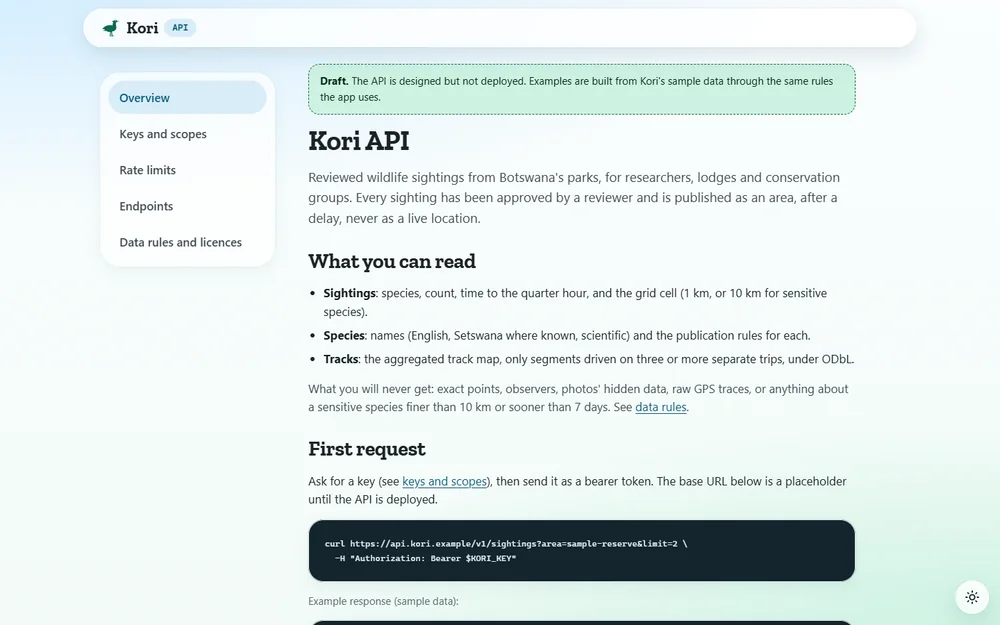
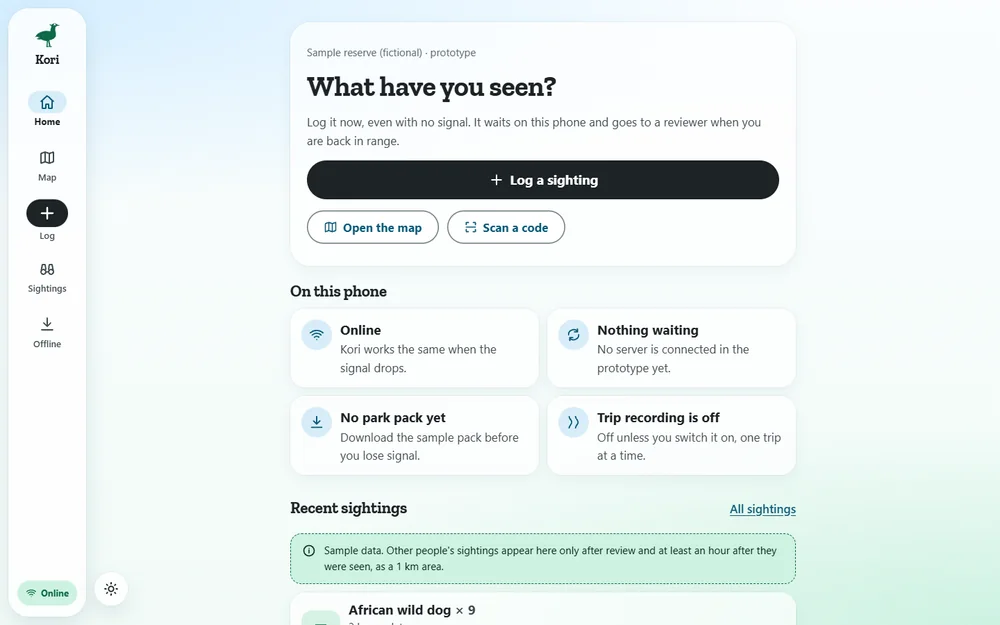
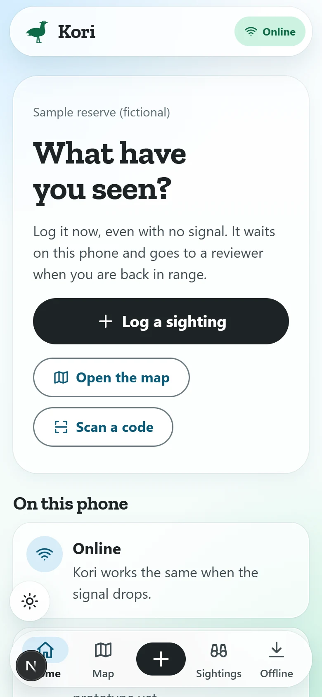
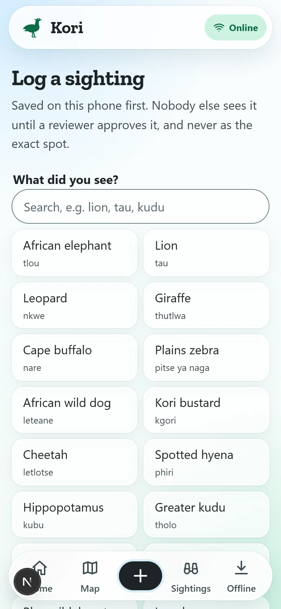
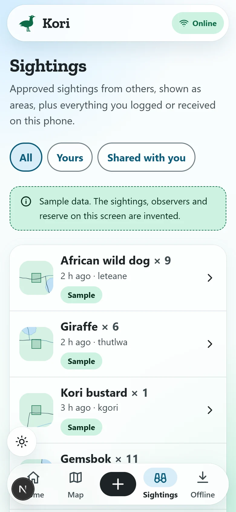
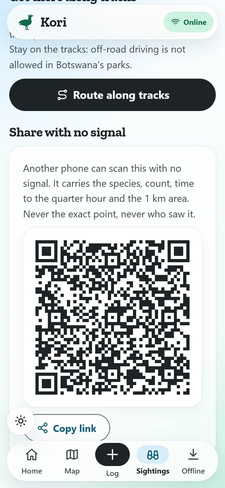
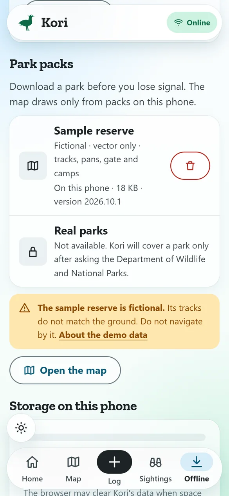
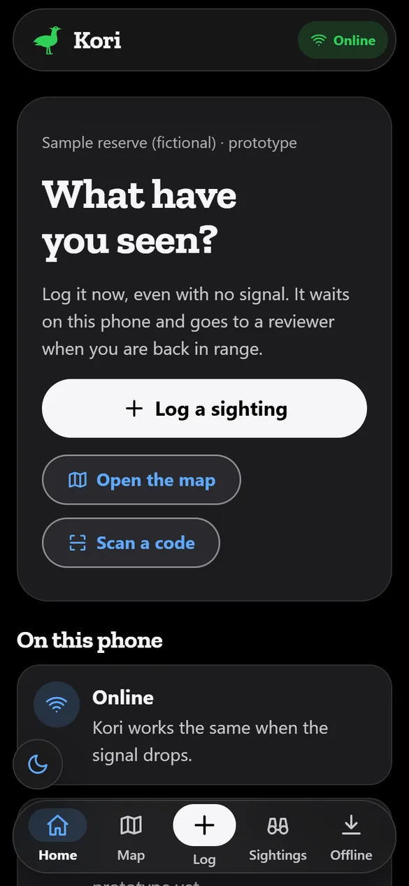

# Kori

Kori is an offline-first safari and wildlife app for Botswana, named after the
kori bustard (kgori in Setswana), the national bird.

You log a sighting with no signal (species, time, photos, a coarse location),
and it waits on your phone until a connection returns. Reviewers approve
sightings before anyone else sees them. Park maps are downloaded before the
trip, so the map and your GPS position work with no mobile signal. Guidance to
a sighting follows known roads and tracks only, and a sighting can be shared
phone to phone with a QR code.

## Why Kori exists

Botswana's safari routes often pass through places with weak or no mobile
coverage, while ordinary social maps are built around a live connection and an
exact point. That is a bad fit for both the visitor and the wildlife. Kori treats
offline maps, review, publication delay and coarse location cells as one product
problem: the visitor can still record what they saw, but the system never turns
that record into a live pointer to an animal. The result is a field workflow for
visitors and guides, a review workflow for trusted moderators, and a data model
that preserves the difference between a private observation and a safe public
sighting.

## What it looks like

These images are captures of the running prototype in Day colours
(Night uses the same layout in Apple's flat dark colours). Every person,
sighting and figure shown in them is sample data, and the app labels it as such.

<table>
  <tr>
    <td width="50%" valign="top" align="center">
      <br>
      <sub><b>API docs</b> (draft). Keys, limits and endpoints for researchers and lodges.</sub>
    </td>
    <td width="50%" valign="top" align="center">
      <br>
      <sub><b>Field app on a wide screen.</b> The same app, with a rail instead of the bottom dock.</sub>
    </td>
  </tr>
</table>

On a phone:

<table>
  <tr>
    <td width="50%" valign="top" align="center">
      <br>
      <sub><b>Home.</b> Log a sighting, even with no signal.</sub>
    </td>
    <td width="50%" valign="top" align="center">
      <br>
      <sub><b>Log a sighting.</b> Saved on the phone first.</sub>
    </td>
  </tr>
  <tr>
    <td width="50%" valign="top" align="center">
      <br>
      <sub><b>Sightings.</b> Each is shown as a 1 km area, never a point.</sub>
    </td>
    <td width="50%" valign="top" align="center">
      <br>
      <sub><b>A sighting with its QR share.</b> Another phone scans it with no signal.</sub>
    </td>
  </tr>
  <tr>
    <td width="50%" valign="top" align="center">
      <br>
      <sub><b>Offline and packs.</b> What is stored on the phone.</sub>
    </td>
  </tr>
  <tr>
    <td width="50%" valign="top" align="center">
      <br>
      <sub><b>Night colours</b>, home.</sub>
    </td>
  </tr>
</table>

## State of the work

An early prototype. The web apps run in the browser with **sample data**. The
backend is built and tested and starts with PostGIS in CI, but it is not
deployed or connected to the apps yet. The register of every instruction and
every piece of work, each with its dated evidence, is
[`docs/WORK_ORDERS.md`](docs/WORK_ORDERS.md); the tables below summarise it.

## What works and what remains

| Area | State |
| --- | --- |
| Logging a sighting (species, time, photos, a coarse location) into the phone's storage (IndexedDB), with an offline outbox | Works in the browser |
| Photos redrawn on the phone to strip hidden location data before they are stored | Works in the browser |
| Downloading the sample park pack and drawing it with MapLibre, with no network tiles | Works in the browser: the pack downloads (18 KB), the map draws it, your GPS position shows on it |
| Routing to a sighting along the pack's tracks only | Works over the sample graph, covered by tests; the off-route warning has not been tried with a moving GPS fix on a real phone |
| QR share and scan | Works in the browser: a sighting past its delay shows a QR code, and the scanner (`BarcodeDetector`, with `jsQR` as the fallback) decodes it. **Not yet tried** with a real camera on a real phone |
| Opt-in trip recording and the aggregated track map | **Not started** |
| Review console: queue, checks, approve or reject, species sensitivity, audit log | The three pages build and return 200 with the sample-data notice. Approving and rejecting have **not** been clicked through in a browser; there is no reviewer sign-in yet |
| Landing site and API docs | Build and pass lint, type-check and `next build` in CI. The API docs are generated from the service's own OpenAPI document but marked draft, because the API they describe is not deployed |
| Day and Night colours | Both pass a computed contrast check (148 of 148 pairs, AA or better, including with reduced transparency). **Not yet tried** with a screen reader |
| Service worker (the app shell available offline) | Registered in code. The headless browser used for checks refused to register it, so it is **unverified** |
| Sign-in, accounts | **Not built.** The apps run with sample data and no account system |
| Data storage | This phone's IndexedDB only, until the apps are connected to the API |

## The backend: real and scaffold

| Part | State |
| --- | --- |
| API service (accounts, scoped keys and quotas, throttling, audit log, uploads, review, trips, track map, packs, the keyed `/v1` endpoints) | **Tested**: `ruff` passes; `pytest`: 93 passed |
| Migrations | **Tested in CI**: an empty PostGIS 16 database migrates to head, the species seed checks out (20 species, 3 sensitive), and the downgrade to base runs |
| Compose smoke test (database and API) | **Runs in CI**: builds and starts the database and API, which report `healthy` |
| Security workflow (Trivy, `npm audit`, `pip-audit`) | **Run once, triaged**: passed; the run caught a critical Next.js advisory, fixed by upgrading to 16.4.3 across all four apps |
| Full local stack (`docker compose up`, every service, including the web apps and monitoring) | **Blocked**: the Docker daemon was not running on the build machine. Only the database and API have been started together, and only in CI |
| Observability: Prometheus, Grafana, Tempo, OpenTelemetry | **Configuration**: wired into the API; never started outside CI; no alert rules |
| Backups and a restore drill | **Not started**: waits on the full stack running once |
| The apps calling the API | **Not started**: `HttpStore` is a scaffold behind a feature flag and has not been run against the API, so the apps keep using the data already on the device |
| Real park pack (Savuti, private) | **Built and verified privately**: an OpenStreetMap vector base map, a routing graph, and checksum-verified Sentinel-2 imagery. 16 of 16 offline checks passed in a headless browser with the network cut. Kept out of the repository and every deployed build pending wildlife-authority guidance |
| Staging and production | **None** |

Every sighting not logged by you, every observer ("Sample observer 1" and so
on), every review, and the invented API keys in the docs are sample data,
marked as such where they appear.

## Safety and privacy

Kori never shows a live animal location: others see a sighting only after
review, at least an hour later, and only as a 1 km area. Sensitive species
(rhino and pangolin in the prototype), dens and nests are a 10 km area after
7 days, and are never guided to or shared. Guidance stays on existing tracks.
Predicted tracks are labelled with their confidence and are off by default.
Trip recording is opt-in per trip, and shared trips are trimmed and deleted on
expiry. The rules run in both the browser and the API, and tests keep the two
identical. Full rules: [`docs/SAFETY_AND_PRIVACY.md`](docs/SAFETY_AND_PRIVACY.md).

## Repository layout

| Path | What it is |
| --- | --- |
| `apps/field/` | The field app (Next.js 16): home, log, map, sightings, sighting with QR share, scan, offline and packs, trips |
| `apps/landing/` | The landing site |
| `apps/review/` | The review console: queue with checks, approve or reject, species rules, audit log |
| `apps/api-docs/` | The API docs (draft); the endpoint table comes from the API's OpenAPI document |
| `shared/` | Tokens, mark and icons, species, publication rules, the sample reserve, routing, share codes; copied into each app by `node scripts/sync-shared.mjs` |
| `api/` | The FastAPI service, Alembic migrations and tests ([`api/README.md`](api/README.md)) |
| `database/`, `compose.yaml` | The PostGIS image and the local stack |
| `observability/`, `ops/`, `deploy/` | Monitoring, backup and recovery, release and Kubernetes scaffolds |
| `docs/` | Safety and privacy rules, design principles, ADRs, deploy, observability and operations guides, the work-order register |
| `tests/`, `scripts/` | Tests for the shared code; sync, name gate, reuse measurement |

How the parts fit: [`ARCHITECTURE.md`](ARCHITECTURE.md). Security:
[`SECURITY.md`](SECURITY.md). Conventions: [`CONTRIBUTING.md`](CONTRIBUTING.md).

## How it is built

- **Four Next.js apps, one shared folder.** `apps/field`, `apps/landing`,
  `apps/review` and `apps/api-docs` each deploy on their own, one Vercel
  project per app. `shared/` holds the tokens, mark, species list, publication
  rules, the sample reserve, routing and share codes; `scripts/sync-shared.mjs`
  copies it into each app, and CI fails if a copy drifts.
- **A data layer behind an interface** (`KoriStore`, [ADR 0002](docs/adr/0002-indexeddb-behind-a-store-interface.md)).
  `LocalStore` is the default and writes to IndexedDB; `HttpStore` is a
  scaffold behind `NEXT_PUBLIC_KORI_DATA_SOURCE=http` that has not been run
  against the API.
- **The publication rules live in two places, kept identical.** The 1 km and
  10 km cell sizes, the 1 hour and 7 day delays, and the no-guidance rule for
  sensitive species are implemented once in `shared/rules.ts` for the browser
  and once in `api/app/services/publication.py` for the server; a test
  computes the same grid cells with both. The species list is duplicated the
  same way and compared row by row.
- **Contrast is computed, not estimated.** `scripts/check-contrast.mjs`
  composites every translucent surface over the washes and the map and
  measures each pair in Day, Night and with reduced transparency; the current
  build passes 148 of 148 pairs at AA or better, and CI runs it on every
  change.
- **Backend** (`api/`): a FastAPI and SQLAlchemy service with Alembic
  migrations, a PostGIS database, a scheduler for trip expiry and cleanup, and
  keyed `/v1` endpoints for researchers and lodges.
- **Docker** (`compose.yaml`, `observability/`, `deploy/`): a local stack with
  the database, API, scheduler and monitoring, plus release and Kubernetes
  scaffolds for later.
- **Decisions** are recorded in [docs/adr](docs/adr/README.md); security in
  [SECURITY.md](SECURITY.md); how to contribute in [CONTRIBUTING.md](CONTRIBUTING.md).

## Run it

Node 22.18 or later; Python 3.12 or later; Docker for the stack.

```sh
cd apps/field && npm ci && npm run dev        # http://localhost:3100 (landing 3000, review 3300, api-docs 3400)
cd api && python -m venv .venv && .venv/Scripts/python -m pip install -e ".[dev]" && .venv/Scripts/python -m pytest
docker compose up                             # database, API, scheduler, apps, monitoring
```

Repository checks:

```sh
node --test "tests/*.test.ts"          # shared rules, routing, share codes
node scripts/sync-shared.mjs --check   # the copies of shared/ match the source
node scripts/check-names.mjs           # no names from other products in the tree
docker compose config --quiet          # the stack definition is valid
```

## Deploying

The web apps deploy to Vercel, one project per app; the owner's steps are in
[`docs/DEPLOY.md`](docs/DEPLOY.md). Nothing is deployed yet.

## Dependencies

| Package | Why | Licence |
| --- | --- | --- |
| next, react, react-dom | The interface, in all four apps | MIT |
| maplibre-gl | Drawing the offline map | BSD-3-Clause |
| pmtiles | Reading a downloaded map pack with no tile server | BSD-3-Clause |
| idb | A small Promise wrapper over IndexedDB | ISC |
| qrcode | Drawing the QR codes sightings are shared with | MIT |
| jsqr | Decoding a QR code when the browser has no `BarcodeDetector` | Apache-2.0 |
| @fontsource/noto-sans, @fontsource/zilla-slab | Self-hosted display and body typefaces | OFL-1.1 |
| fastapi | The API framework | MIT |
| sqlalchemy, alembic, geoalchemy2 | Models, migrations and PostGIS geometry | MIT |
| psycopg | The PostgreSQL driver | LGPL-3.0 |
| pyjwt | API key and session tokens | MIT |
| pydantic-settings | Typed configuration | MIT |
| uvicorn, httpx | The ASGI server and the HTTP client used by the scheduler | BSD-3-Clause |
| prometheus-client, opentelemetry-\* | Metrics and tracing | Apache-2.0 |

Development only: ESLint, TypeScript and the Node test runner per app;
`pytest` and `ruff` for the API. The full, versioned lists are each app's
`package.json` and [`api/pyproject.toml`](api/pyproject.toml).

## Where the code came from

Kori started from the owner's own earlier platform. [`PROVENANCE.md`](PROVENANCE.md)
lists every copied file and the measured reuse: 35% of Kori's non-blank lines
are verbatim from it (73% of the API, 84% of the infrastructure, 2% of the web
apps).

## Licence

Copyright (c) 2026 Mooketsi Vincent Magwaza. All rights reserved. There is no
licence file: no permission is granted to use, copy, modify or distribute this
code.
